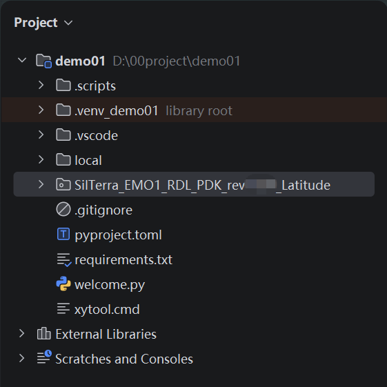

Install PhotoCAD and SilTerra PDK
=======================================

After installing PyCharm, you can create a **PhotoCAD** project by following the instructions in the **PhotoCAD Launcher**. Once created, you can find the completed **fnpcell** and **gpdk** packages in ``Lib>site-packages``. **fnpcell** is the main package of **PhotoCAD**, which is used for parametric layout component scripts and layout routing scripts. **gpdk** is a collection of all examples in **PhotoCAD**. It contains both component cell layout scripts and other design templates based on parametric component cells.

To install SilTerra PDK package to **PhotoCAD**, extract ``SilTerra_EMO1_RDL_PDK_rev10p0_Latitude.zip`` to the project folder.

