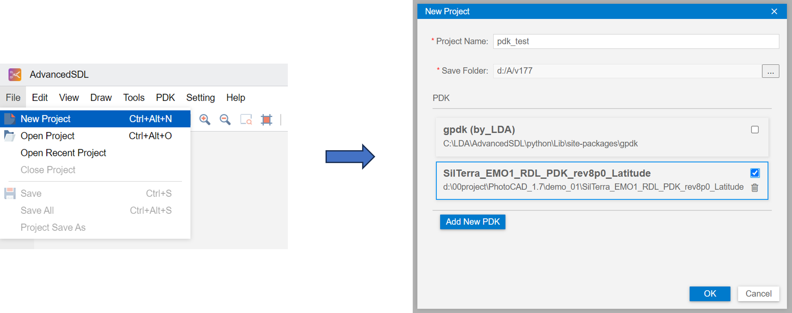
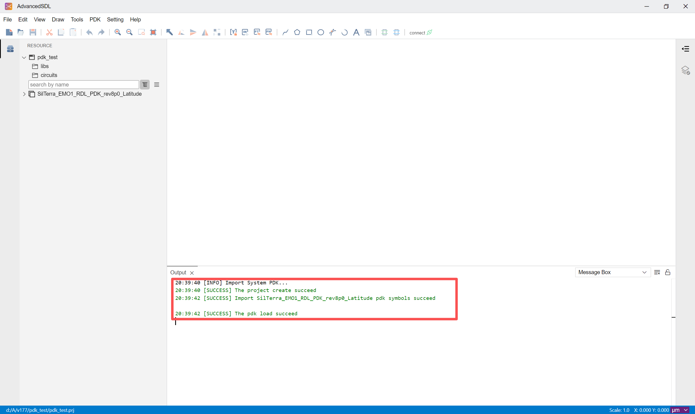
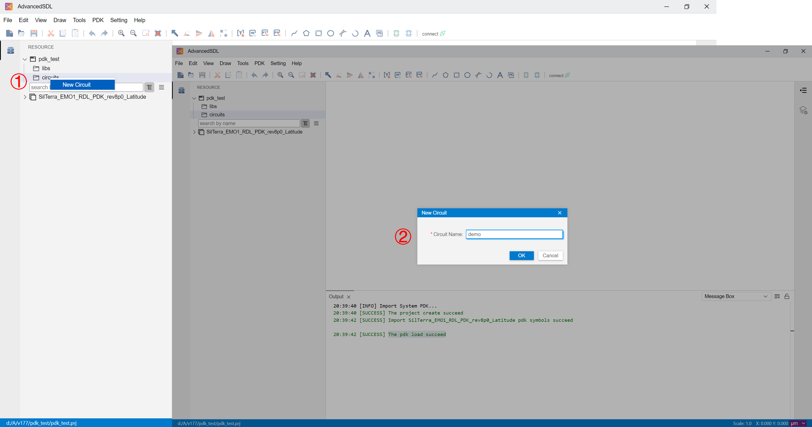
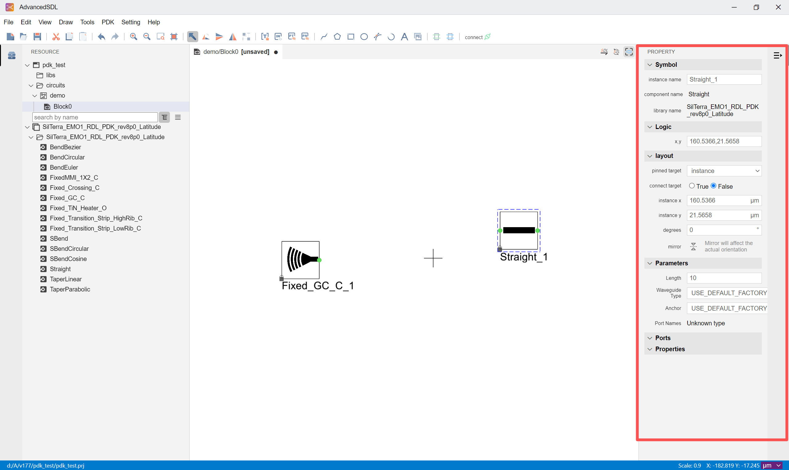
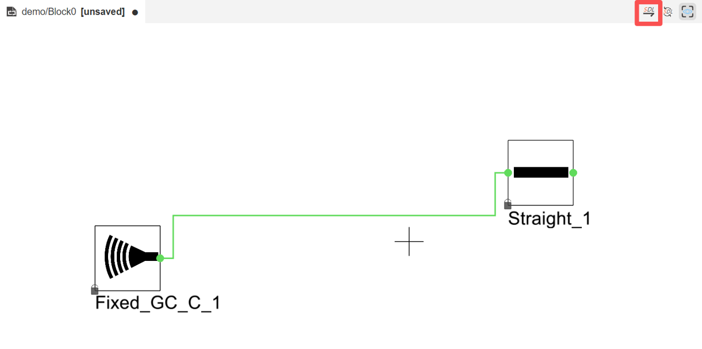
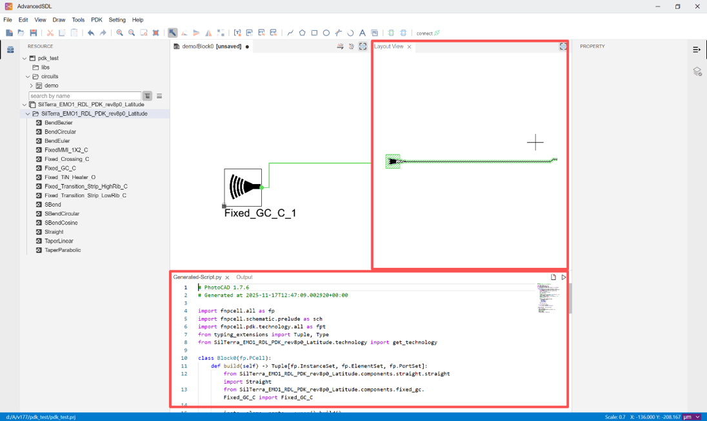
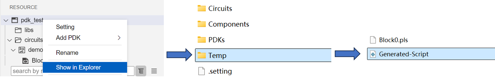

AdvancedSDL
=======================================

Import SilTerra PDK into AdvancedSDL
*******************************************

Open AdvancedSDL and click ``File > New Project``.
Enter the project name and path, select ``SilTerra`` PDK in the PDK column, and click ``Save``.

Wait for the contents of ``The pdk load succeed`` to appear in the output.

Right-click on the ``circuits`` of the project, click ``New Circuit``, type ``circuit name`` and click ``Save``.

Drag components to the center region. Click on the component, the parameters of the component can be adjusted on the right side.

Once the parameters are set, connect the ports to route the components and click SDL in the upper right.

The corresponding layout is displayed in the ``Layout View``. And it generates python layout code called ``Generated-Script.py``, which can be run and used in **PhotoCAD**.

The ``Generated-Script.py`` can be run in **PhotoCAD** and modified to create a new layout. The script is saved in the project's Temp folder.

You can also easily import a specific component to **AdvancedSDL** on **PhotoCAD** using ``fp.export_schematic``. See ``gpdk > examples`` for more information.
