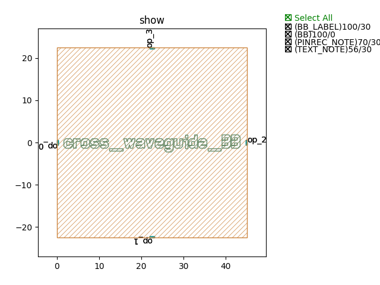

Crossings
#############################

cross_waveguide_BB
**********************************************************

+-------------------+-----------------------------+-------------+
|     ports         |     waveguide type          | orientation |
+===================+=============================+=============+
| op_0              | TECH.WG.RIB1.C.WIRE         | 180         |
+-------------------+-----------------------------+-------------+
| op_1              | TECH.WG.RIB1.C.WIRE         | -90         |
+-------------------+-----------------------------+-------------+
| op_2              | TECH.WG.RIB1.C.WIRE         | 0           |
+-------------------+-----------------------------+-------------+
| op_3              | TECH.WG.RIB1.C.WIRE         | 90          |
+-------------------+-----------------------------+-------------+
