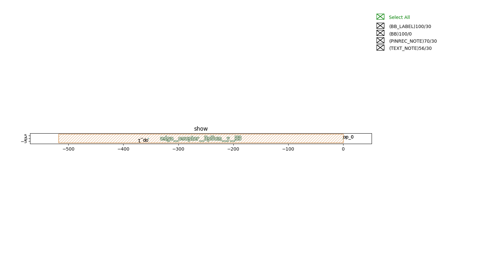
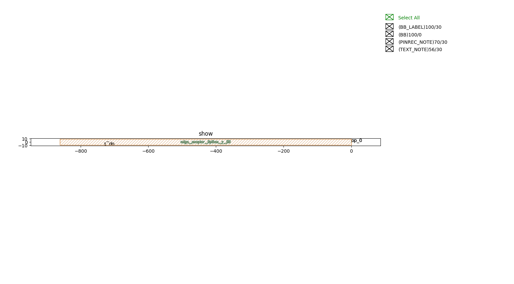

Edge Couplers (EC)
#############################

edge_coupler_3p5um_y_BB
**********************************************************

* Note that the **op_1** of ``edge_coupler_3p5um_y_BB`` should be placed at x=0 um or x=20000 um in the ``Block``.

+-------------------+-----------------------------+-------------+
|     ports         |     waveguide type          | orientation |
+===================+=============================+=============+
| op_0              | TECH.WG.RIB1.C.WIRE         | 0           |
+-------------------+-----------------------------+-------------+
| op_1              | TECH.WG.RIB1.C.WIRE         | 180         |
+-------------------+-----------------------------+-------------+

edge_coupler_6p5um_y_BB
**********************************************************

* Note that the **op_1** of ``edge_coupler_6p5um_y_BB`` should be placed at x=0 um or x=20000 um in the ``Block``.

+-------------------+-----------------------------+-------------+
|     ports         |     waveguide type          | orientation |
+===================+=============================+=============+
| op_0              | TECH.WG.RIB1.C.WIRE         | 0           |
+-------------------+-----------------------------+-------------+
| op_1              | TECH.WG.RIB1.C.WIRE         | 180         |
+-------------------+-----------------------------+-------------+
