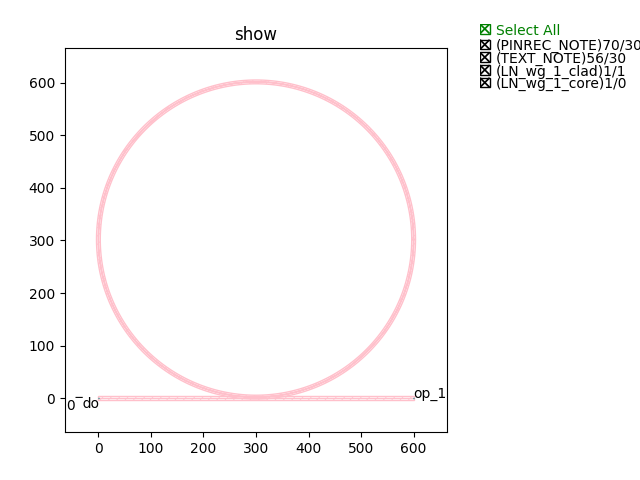

Microring
############################

micro_ring
******************************************************

+----------------+----------------------+------------------------------------------------------------------------------------------------------+
| Parameters     |     Range            | Description                                                                                          |
+================+======================+======================================================================================================+
|gap             | > 0                  | Gap between straight waveguide and micro ring                                                        |
+----------------+----------------------+------------------------------------------------------------------------------------------------------+
|R               | > 0                  | Radius of micro ring                                                                                 |
+----------------+----------------------+------------------------------------------------------------------------------------------------------+
|core_width      | > 0                  | Core width of waveguide                                                                              |
+----------------+----------------------+------------------------------------------------------------------------------------------------------+
|cladding_width  | > 0                  | Cladding width of waveguide                                                                          |
+----------------+----------------------+------------------------------------------------------------------------------------------------------+

+----------------------+------------------------+-------------+
|      ports           |     waveguide type     | orientation |
+======================+========================+=============+
|op_0                  |  TECH.WG.RIB1.C.WIRE   |     180     |
+----------------------+------------------------+-------------+
|op_1                  |  TECH.WG.RIB1.C.WIRE   |        0    |
+----------------------+------------------------+-------------+
