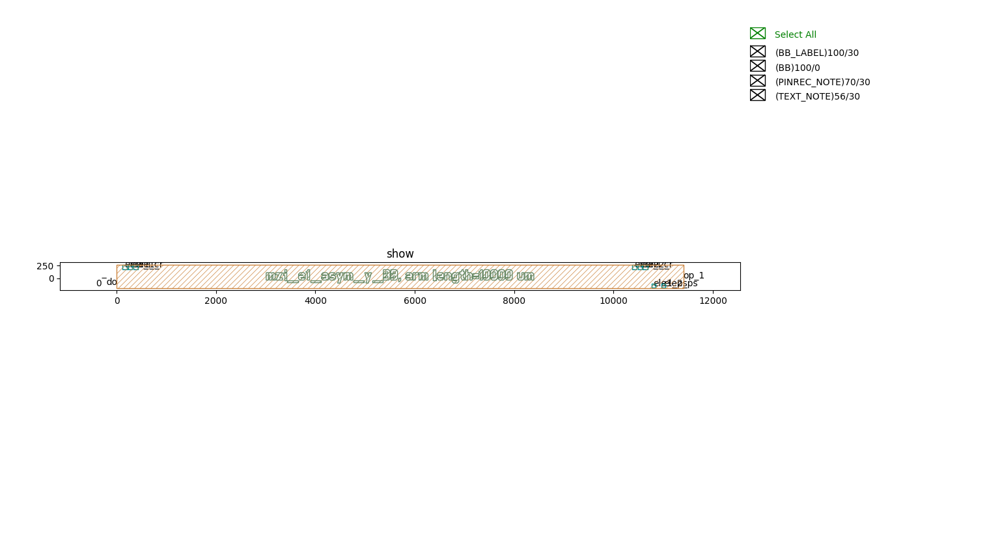
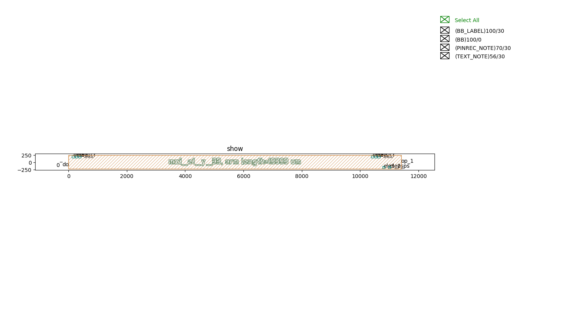
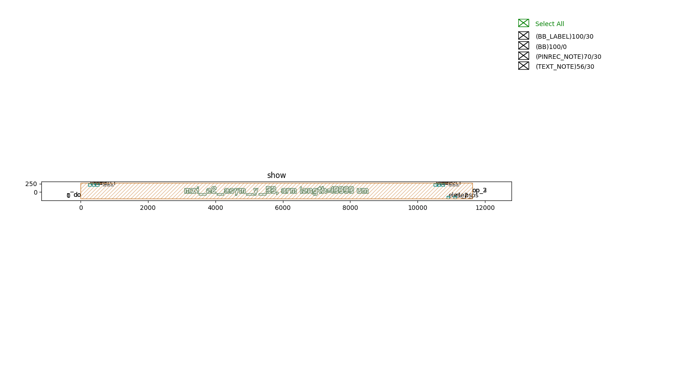
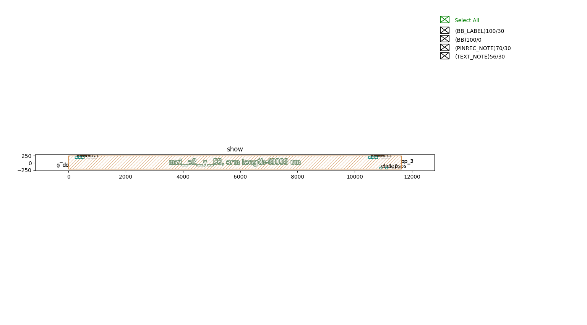
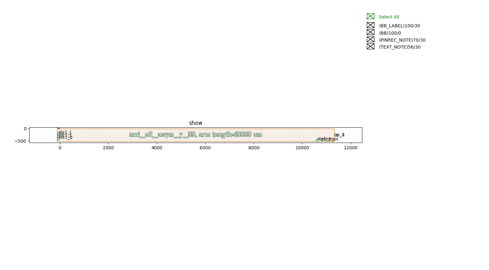
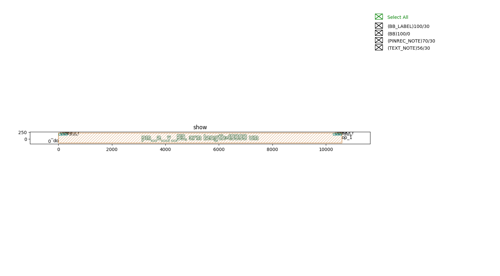
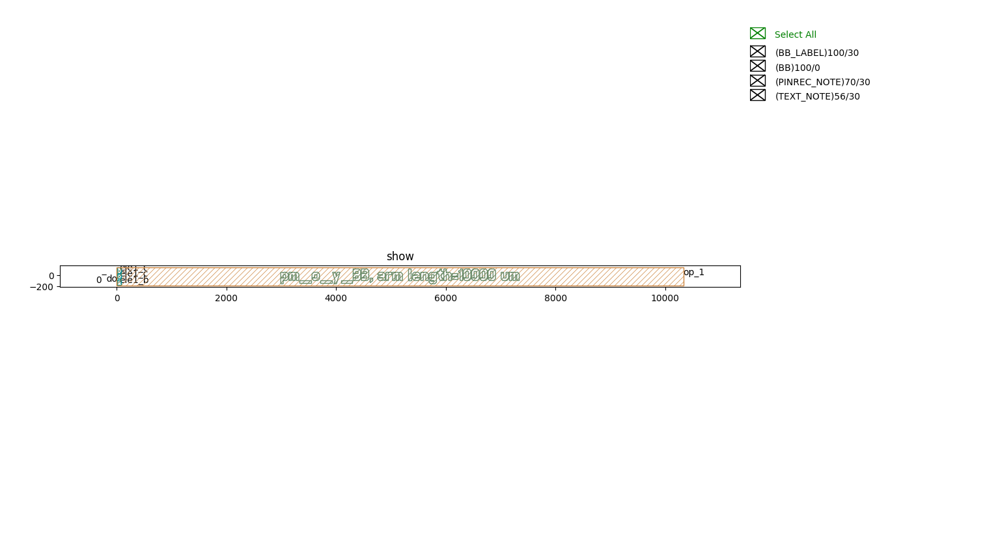

Mach-Zehnder interferometers (MZI)
#############################################

mzi_e1_asym_y_BB
**********************************************************

+----------------+----------------------+------------------------------------------------------------------------------------------------------+
| Parameters     |     Range            | Description                                                                                          |
+================+======================+======================================================================================================+
|arm_length      | 0.5 cm to 1.5 cm     | The arm length should be a multiple of 50 um, or it would be rounded to a multiple of 50 um.         |
+----------------+----------------------+------------------------------------------------------------------------------------------------------+

+-------------------+-----------------------------+-------------+
|     ports         |     waveguide type          | orientation |
+===================+=============================+=============+
| op_0              | TECH.WG.RIB1.C.WIRE         | 180         |
+-------------------+-----------------------------+-------------+
| op_1              | TECH.WG.RIB1.C.WIRE         | 0           |
+-------------------+-----------------------------+-------------+
| ele1_l            | TECH.METAL.M1.W100          |  90         |
+-------------------+-----------------------------+-------------+
| ele1_c            | TECH.METAL.M1.W80           |  90         |
+-------------------+-----------------------------+-------------+
| ele1_r            | TECH.METAL.M1.W100          |  90         |
+-------------------+-----------------------------+-------------+
| ele2_l            | TECH.METAL.M1.W100          |  90         |
+-------------------+-----------------------------+-------------+
| ele2_c            | TECH.METAL.M1.W80           |  90         |
+-------------------+-----------------------------+-------------+
| ele2_r            | TECH.METAL.M1.W100          |  90         |
+-------------------+-----------------------------+-------------+
| ele1_ps           | TECH.METAL.M1.W80           | -90         |
+-------------------+-----------------------------+-------------+
| ele2_ps           | TECH.METAL.M1.W80           | -90         |
+-------------------+-----------------------------+-------------+

mzi_e1_y_BB
**********************************************************

+----------------+----------------------+------------------------------------------------------------------------------------------------------+
| Parameters     |     Range            | Description                                                                                          |
+================+======================+======================================================================================================+
|arm_length      | 0.5 cm to 1.5 cm     | The arm length should be a multiple of 50 um, or it would be rounded to a multiple of 50 um.         |
+----------------+----------------------+------------------------------------------------------------------------------------------------------+

+-------------------+-----------------------------+-------------+
|     ports         |     waveguide type          | orientation |
+===================+=============================+=============+
| op_0              | TECH.WG.RIB1.C.WIRE         | 180         |
+-------------------+-----------------------------+-------------+
| op_1              | TECH.WG.RIB1.C.WIRE         | 0           |
+-------------------+-----------------------------+-------------+
| ele1_l            | TECH.METAL.M1.W100          |  90         |
+-------------------+-----------------------------+-------------+
| ele1_c            | TECH.METAL.M1.W80           |  90         |
+-------------------+-----------------------------+-------------+
| ele1_r            | TECH.METAL.M1.W100          |  90         |
+-------------------+-----------------------------+-------------+
| ele2_l            | TECH.METAL.M1.W100          |  90         |
+-------------------+-----------------------------+-------------+
| ele2_c            | TECH.METAL.M1.W80           |  90         |
+-------------------+-----------------------------+-------------+
| ele2_r            | TECH.METAL.M1.W100          |  90         |
+-------------------+-----------------------------+-------------+
| ele1_ps           | TECH.METAL.M1.W80           | -90         |
+-------------------+-----------------------------+-------------+
| ele2_ps           | TECH.METAL.M1.W80           | -90         |
+-------------------+-----------------------------+-------------+

mzi_e2_asym_y_BB
**********************************************************

+----------------+----------------------+------------------------------------------------------------------------------------------------------+
| Parameters     |     Range            | Description                                                                                          |
+================+======================+======================================================================================================+
|arm_length      | 0.5 cm to 1.5 cm     | The arm length should be a multiple of 50 um, or it would be rounded to a multiple of 50 um.         |
+----------------+----------------------+------------------------------------------------------------------------------------------------------+

+-------------------+-----------------------------+-------------+
|     ports         |     waveguide type          | orientation |
+===================+=============================+=============+
| op_0              | TECH.WG.RIB1.C.WIRE         | 180         |
+-------------------+-----------------------------+-------------+
| op_1              | TECH.WG.RIB1.C.WIRE         | 180         |
+-------------------+-----------------------------+-------------+
| op_2              | TECH.WG.RIB1.C.WIRE         |   0         |
+-------------------+-----------------------------+-------------+
| op_3              | TECH.WG.RIB1.C.WIRE         |   0         |
+-------------------+-----------------------------+-------------+
| ele1_l            | TECH.METAL.M1.W100          |  90         |
+-------------------+-----------------------------+-------------+
| ele1_c            | TECH.METAL.M1.W80           |  90         |
+-------------------+-----------------------------+-------------+
| ele1_r            | TECH.METAL.M1.W100          |  90         |
+-------------------+-----------------------------+-------------+
| ele2_l            | TECH.METAL.M1.W100          |  90         |
+-------------------+-----------------------------+-------------+
| ele2_c            | TECH.METAL.M1.W80           |  90         |
+-------------------+-----------------------------+-------------+
| ele2_r            | TECH.METAL.M1.W100          |  90         |
+-------------------+-----------------------------+-------------+
| ele1_ps           | TECH.METAL.M1.W80           | -90         |
+-------------------+-----------------------------+-------------+
| ele2_ps           | TECH.METAL.M1.W80           | -90         |
+-------------------+-----------------------------+-------------+

mzi_e2_y_BB
**********************************************************

+----------------+----------------------+------------------------------------------------------------------------------------------------------+
| Parameters     |     Range            | Description                                                                                          |
+================+======================+======================================================================================================+
|arm_length      | 0.5 cm to 1.5 cm     | The arm length should be a multiple of 50 um, or it would be rounded to a multiple of 50 um.         |
+----------------+----------------------+------------------------------------------------------------------------------------------------------+

+-------------------+-----------------------------+-------------+
|     ports         |     waveguide type          | orientation |
+===================+=============================+=============+
| op_0              | TECH.WG.RIB1.C.WIRE         | 180         |
+-------------------+-----------------------------+-------------+
| op_1              | TECH.WG.RIB1.C.WIRE         | 180         |
+-------------------+-----------------------------+-------------+
| op_2              | TECH.WG.RIB1.C.WIRE         |   0         |
+-------------------+-----------------------------+-------------+
| op_3              | TECH.WG.RIB1.C.WIRE         | 0           |
+-------------------+-----------------------------+-------------+
| ele1_l            | TECH.METAL.M1.W100          |  90         |
+-------------------+-----------------------------+-------------+
| ele1_c            | TECH.METAL.M1.W80           |  90         |
+-------------------+-----------------------------+-------------+
| ele1_r            | TECH.METAL.M1.W100          |  90         |
+-------------------+-----------------------------+-------------+
| ele2_l            | TECH.METAL.M1.W100          |  90         |
+-------------------+-----------------------------+-------------+
| ele2_c            | TECH.METAL.M1.W80           |  90         |
+-------------------+-----------------------------+-------------+
| ele2_r            | TECH.METAL.M1.W100          |  90         |
+-------------------+-----------------------------+-------------+
| ele1_ps           | TECH.METAL.M1.W80           | -90         |
+-------------------+-----------------------------+-------------+
| ele2_ps           | TECH.METAL.M1.W80           | -90         |
+-------------------+-----------------------------+-------------+

mzi_o1_asym_y_BB
**********************************************************

+----------------+----------------------+------------------------------------------------------------------------------------------------------+
| Parameters     |     Range            | Description                                                                                          |
+================+======================+======================================================================================================+
|arm_length      | 0.5 cm to 1.5 cm     | The arm length should be a multiple of 50 um, or it would be rounded to a multiple of 50 um.         |
+----------------+----------------------+------------------------------------------------------------------------------------------------------+

+-------------------+-----------------------------+-------------+
|     ports         |     waveguide type          | orientation |
+===================+=============================+=============+
| op_0              | TECH.WG.RIB1.C.WIRE         | 90          |
+-------------------+-----------------------------+-------------+
| op_1              | TECH.WG.RIB1.C.WIRE         |   0         |
+-------------------+-----------------------------+-------------+
| ele1_t            | TECH.METAL.M1.W100          |  180        |
+-------------------+-----------------------------+-------------+
| ele1_c            | TECH.METAL.M1.W80           | 180         |
+-------------------+-----------------------------+-------------+
| ele1_b            | TECH.METAL.M1.W100          | 180         |
+-------------------+-----------------------------+-------------+
| ele1_ps           | TECH.METAL.M1.W80           | -90         |
+-------------------+-----------------------------+-------------+
| ele2_ps           | TECH.METAL.M1.W80           | -90         |
+-------------------+-----------------------------+-------------+

mzi_o1_y_BB
**********************************************************

+----------------+----------------------+------------------------------------------------------------------------------------------------------+
| Parameters     |     Range            | Description                                                                                          |
+================+======================+======================================================================================================+
|arm_length      | 0.5 cm to 1.5 cm     | The arm length should be a multiple of 50 um, or it would be rounded to a multiple of 50 um.         |
+----------------+----------------------+------------------------------------------------------------------------------------------------------+

+-------------------+-----------------------------+-------------+
|     ports         |     waveguide type          | orientation |
+===================+=============================+=============+
| op_0              | TECH.WG.RIB1.C.WIRE         | 180         |
+-------------------+-----------------------------+-------------+
| op_1              | TECH.WG.RIB1.C.WIRE         |   0         |
+-------------------+-----------------------------+-------------+
| ele1_t            | TECH.METAL.M1.W100          |  180        |
+-------------------+-----------------------------+-------------+
| ele1_c            | TECH.METAL.M1.W80           | 180         |
+-------------------+-----------------------------+-------------+
| ele1_b            | TECH.METAL.M1.W100          | 180         |
+-------------------+-----------------------------+-------------+
| ele1_ps           | TECH.METAL.M1.W80           | -90         |
+-------------------+-----------------------------+-------------+
| ele2_ps           | TECH.METAL.M1.W80           |  -90        |
+-------------------+-----------------------------+-------------+

mzi_o2_asym_y_BB
**********************************************************

+----------------+----------------------+------------------------------------------------------------------------------------------------------+
| Parameters     |     Range            | Description                                                                                          |
+================+======================+======================================================================================================+
|arm_length      | 0.5 cm to 1.5 cm     | The arm length should be a multiple of 50 um, or it would be rounded to a multiple of 50 um.         |
+----------------+----------------------+------------------------------------------------------------------------------------------------------+

+-------------------+-----------------------------+-------------+
|     ports         |     waveguide type          | orientation |
+===================+=============================+=============+
| op_0              | TECH.WG.RIB1.C.WIRE         | 90          |
+-------------------+-----------------------------+-------------+
| op_1              | TECH.WG.RIB1.C.WIRE         |  90         |
+-------------------+-----------------------------+-------------+
| op_2              | TECH.WG.RIB1.C.WIRE         |   0         |
+-------------------+-----------------------------+-------------+
| op_3              | TECH.WG.RIB1.C.WIRE         |   0         |
+-------------------+-----------------------------+-------------+
| ele1_t            | TECH.METAL.M1.W100          |  180        |
+-------------------+-----------------------------+-------------+
| ele1_c            | TECH.METAL.M1.W80           | 180         |
+-------------------+-----------------------------+-------------+
| ele1_b            | TECH.METAL.M1.W100          | 180         |
+-------------------+-----------------------------+-------------+
| ele1_ps           | TECH.METAL.M1.W80           | -90         |
+-------------------+-----------------------------+-------------+
| ele2_ps           | TECH.METAL.M1.W80           | -90         |
+-------------------+-----------------------------+-------------+

mzi_o2_y_BB
**********************************************************

+----------------+----------------------+------------------------------------------------------------------------------------------------------+
| Parameters     |     Range            | Description                                                                                          |
+================+======================+======================================================================================================+
|arm_length      | 0.5 cm to 1.5 cm     | The arm length should be a multiple of 50 um, or it would be rounded to a multiple of 50 um.         |
+----------------+----------------------+------------------------------------------------------------------------------------------------------+

+-------------------+-----------------------------+-------------+
|     ports         |     waveguide type          | orientation |
+===================+=============================+=============+
| op_0              | TECH.WG.RIB1.C.WIRE         | 180         |
+-------------------+-----------------------------+-------------+
| op_1              | TECH.WG.RIB1.C.WIRE         | 180         |
+-------------------+-----------------------------+-------------+
| op_2              | TECH.WG.RIB1.C.WIRE         |   0         |
+-------------------+-----------------------------+-------------+
| op_3              | TECH.WG.RIB1.C.WIRE         |   0         |
+-------------------+-----------------------------+-------------+
| ele1_t            | TECH.METAL.M1.W100          |  180        |
+-------------------+-----------------------------+-------------+
| ele1_c            | TECH.METAL.M1.W80           | 180         |
+-------------------+-----------------------------+-------------+
| ele1_b            | TECH.METAL.M1.W100          | 180         |
+-------------------+-----------------------------+-------------+
| ele1_ps           | TECH.METAL.M1.W80           | -90         |
+-------------------+-----------------------------+-------------+
| ele2_ps           | TECH.METAL.M1.W80           | -90         |
+-------------------+-----------------------------+-------------+

pm_e_y_BB
**********************************************************

+----------------+----------------------+------------------------------------------------------------------------------------------------------+
| Parameters     |     Range            | Description                                                                                          |
+================+======================+======================================================================================================+
|arm_length      | 0.5 cm to 1.5 cm     | The arm length should be a multiple of 50 um, or it would be rounded to a multiple of 50 um.         |
+----------------+----------------------+------------------------------------------------------------------------------------------------------+

+-------------------+-----------------------------+-------------+
|     ports         |     waveguide type          | orientation |
+===================+=============================+=============+
| op_0              | TECH.WG.RIB1.C.WIRE         | 180         |
+-------------------+-----------------------------+-------------+
| op_1              | TECH.WG.RIB1.C.WIRE         |   0         |
+-------------------+-----------------------------+-------------+
| ele1_l            | TECH.METAL.M1.W100          |  90         |
+-------------------+-----------------------------+-------------+
| ele1_c            | TECH.METAL.M1.W80           |  90         |
+-------------------+-----------------------------+-------------+
| ele1_r            | TECH.METAL.M1.W100          |  90         |
+-------------------+-----------------------------+-------------+
| ele2_l            | TECH.METAL.M1.W100          |  90         |
+-------------------+-----------------------------+-------------+
| ele2_c            | TECH.METAL.M1.W80           | 90          |
+-------------------+-----------------------------+-------------+
| ele2_r            | TECH.METAL.M1.W100          | 90          |
+-------------------+-----------------------------+-------------+

pm_o_y_BB
**********************************************************

+----------------+----------------------+------------------------------------------------------------------------------------------------------+
| Parameters     |     Range            | Description                                                                                          |
+================+======================+======================================================================================================+
|arm_length      | 0.5 cm to 1.5 cm     | The arm length should be a multiple of 50 um, or it would be rounded to a multiple of 50 um.         |
+----------------+----------------------+------------------------------------------------------------------------------------------------------+

+-------------------+-----------------------------+-------------+
|     ports         |     waveguide type          | orientation |
+===================+=============================+=============+
| op_0              | TECH.WG.RIB1.C.WIRE         |  180        |
+-------------------+-----------------------------+-------------+
| op_1              | TECH.WG.RIB1.C.WIRE         |   0         |
+-------------------+-----------------------------+-------------+
| ele1_t            | TECH.METAL.M1.W100          | 180         |
+-------------------+-----------------------------+-------------+
| ele1_c            | TECH.METAL.M1.W80           | 180         |
+-------------------+-----------------------------+-------------+
| ele1_b            | TECH.METAL.M1.W100          | 180         |
+-------------------+-----------------------------+-------------+
